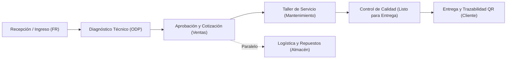

# SYNAPSE v2.5 — Plataforma Integral de Gestión Operativa y Trazabilidad Técnica

> **Sistema Especializado para Talleres de Mantenimiento Electromecánico y Motosoldadoras**  
> **Desarrollador / Autor:** Br. Gersson Ortiz — Powered by Venllas  
> **Fecha de Emisión:** Octubre 2026 | Arequipa, Perú  

---

## 1. Resumen Ejecutivo

**SYNAPSE** es una solución web empresarial desarrollada a medida para digitalizar, transparentar y acelerar el ciclo completo de servicio técnico en talleres de maquinaria industrial (motosoldadoras, equipos de soldadura y fuerza motriz).

El sistema sustituye las hojas de cálculo dispersas, pizarras físicas de tiza o plumón y la comunicación informal de mensajería por una plataforma centralizada y en tiempo real. Esto permite sincronizar las áreas de **Recepción, Diagnóstico Técnico, Ventas, Logística/Almacén y Operaciones**, reduciendo los tiempos muertos entre etapas hasta en un 40% y brindando trazabilidad completa a los clientes finales.



---

## 2. Problemática Resuelta y Valor de Negocio

| Situación Tradicional en Taller | Solución con SYNAPSE | Impacto en el Negocio |
|---|---|---|
| **Pérdida de historial de equipos:** Desconocimiento de fallas previas o repuestos cambiados anteriormente. | **DNA del Equipo por Número de Serie:** Registro clínico digital histórico accesible en un clic o escaneo QR. | Diagnósticos 50% más rápidos y reducción de garantías repetitivas. |
| **Cuellos de botella entre taller y almacén:** El taller se paraliza administrativamente si faltan piezas. | **Líneas Desacopladas:** El servicio técnico avanza mientras Almacén gestiona entregas parciales/totales independientemente. | Incremento de la capacidad operativa y eliminación de esperas inactivas. |
| **Llamadas continuas de clientes consultando estado:** Sobrecarga a recepción con "¿Cómo va mi equipo?". | **QR Universal y Documentación Pública:** El cliente escanea la etiqueta física de su equipo y consulta el informe oficial y estado al instante. | Aumento drástico de la satisfacción del cliente y ahorro de horas-hombre en recepción. |
| **Falta de métricas de rendimiento:** Desconocimiento de qué marcas o modelos generan más demoras o costos. | **Módulo Predictivo & Auditoría con NLP:** Pronóstico de entrega en días hábiles y análisis de causas de retraso por modelo y área. | Cotizaciones exactas y negociación informada con proveedores. |

---

## 3. Módulos y Capacidades del Sistema

### 3.1. Pizarra Virtual de Taller en Tiempo Real (Live Kanban)
- **Sincronización instantánea:** Cambios de estado visibles en segundos sin recargar pantalla gracias a WebSockets (Supabase Realtime).
- **Semáforo y Clasificación VIP:** Priorización visual (3 niveles con estrellas e iluminación pulsante) para clientes estratégicos o urgencias operativas.
- **Modo Pantalla Completa / Quiosco:** Diseñado para proyectarse continuamente en televisores o monitores dentro de la nave de taller.
- **Reloj Operativo Sincronizado:** Hora oficial de Arequipa (Perú) para control riguroso de jornada y turnos.

### 3.2. Línea Desacoplada: Servicio de Taller vs. Gestión de Repuestos
- Rompe la dependencia rígida: los técnicos continúan desarmado, limpieza y mantenimiento sin que el sistema bloquee el avance por falta de repuestos.
- **Panel de Almacén:** Registro de entregas parciales o totales de repuestos aprobados con estados automáticos (`Sin repuestos`, `Parcial`, `Completo`).
- Trazabilidad de quién entregó cada pieza, fecha exacta y notas de piezas equivalentes o compatibles.

### 3.3. Sistema de Trazabilidad QR y Ficha Técnica Pública
- **Generación directa de etiquetas físicas:** Formato optimizado para impresión con membrete institucional, datos del equipo y código QR de alta resolución con logo corporativo embebido.
- **Doble modalidad inteligente:**
  - *Equipos con número de serie:* Dirige a `/doc/[serial]`, mostrando toda la hoja de vida histórica y enlaces directos al informe PDF de servicio.
  - *Equipos sin serie o con placa desgastada:* Dirige a `/doc/fr/[fr]` para validar ese ingreso específico sin perder trazabilidad.
- **Acceso público sin contraseña:** Permite a operadores de campo de minería o construcción auditar el estado del equipo desde su celular.

### 3.4. Motor Predictivo de Tiempos y Auditoría por Modelo
- **Cálculo de Lead Time en Días Hábiles:** Excluye domingos y feriados nacionales configurables en base de datos.
- **Percentiles Estadísticos (p20 optimista, p80 pesimista):** Evita que casos aislados distorsionen la estimación de entrega.
- **Minería de Texto (NLP) sobre causas de demora:** Categoriza retrasos en *Repuestos/Importación*, *Falla Eléctrica Compleja*, *Aprobación de Cliente* o *Control de Calidad*, asociándolo al rol responsable.

### 3.5. Sistema de Comunicaciones por Correo en Hilo Único
- **Agrupamiento RFC 2822:** Respuestas automáticas mediante Resend agrupadas bajo el mismo hilo de conversación en Gmail y Outlook (`In-Reply-To` / `References`).
- **Soporte de Lote (Batch):** Un solo correo consolidado cuando un cliente ingresa múltiples máquinas simultáneamente.
- **Despachos automáticos:** Notificaciones formales con informe PDF adjunto en hitos clave (Recepción, Aprobación de Presupuesto, Culminación).

---

## 4. Arquitectura Tecnológica y Seguridad

El sistema está construido bajo estándares modernos de la industria de software:

- **Frontend & Backend:** Next.js 16 (App Router) y TypeScript en modo estricto.
- **Diseño & Experiencia:** Tailwind CSS con estética *Cyber Glassmorphism* (adaptable a baja luz de planta industrial y oficinas).
- **Base de Datos & Seguridad:** PostgreSQL con políticas **RLS (Row Level Security)** que blindan la información a nivel de registro según el rol (`superadmin`, `admin`, `operaciones`, `recepcion`, `almacen`, `visualizador`).
- **Audit Log Inmutable:** Cada cambio de estado, fecha u operador queda registrado de forma permanente sin posibilidad de alteración manual.

---

## 5. Propuesta Económica: Licenciamiento vs. Compra Definitiva

Para brindar flexibilidad financiera a la empresa cliente, se estructuran dos modalidades de contratación fundamentadas en el alcance tecnológico desarrollado hasta la versión 2.5:

```
                                OPCIONES DE ADQUISICIÓN
                                           │
         ┌─────────────────────────────────┴─────────────────────────────────┐
         ▼                                                                   ▼
    MODALIDAD A                                                         MODALIDAD B
SaaS / Licencia Mensual                                            Compra de Código y Propiedad
 (Bajo costo inicial + soporte)                                       (Activo propio + autonomía)
```

---

### Opción A: Modelo de Suscripción / Licenciamiento (SaaS)

Pensado para talleres que buscan **mínimo desembolso inicial**, delegando la infraestructura, seguridad, respaldos y soporte técnico continuo en el desarrollador.

| Concepto | Costo Estimado (PEN / USD) | Frecuencia |
|---|---|---|
| **Costo de Licencia / Uso de Plataforma** (Hasta 15 usuarios concurrentes) | **S/ 650.00** (~$175 USD) | Mensual |
| **Setup Inicial & Capacitación** (Carga de catálogo base, configuración de correos e inducción al personal) | **S/ 1,200.00** (~$320 USD) | Pago único |
| **Plan Anual Prepago (15% de descuento)** | **S/ 6,630.00 / año** | Anual |

#### ¿Qué incluye la Licencia Mensual?
1. Acceso total a todos los módulos actuales (Pizarra, Equipos, DNA, QR, Auditoría, Correo, Almacén).
2. Mantenimiento correctivo y resolución de incidencias en menos de 24 horas.
3. Copias de seguridad diarias automatizadas de la base de datos PostgreSQL.
4. Actualizaciones menores del sistema y ajustes por cambios de feriados nacionales.
5. Soporte técnico directo vía WhatsApp y canal remoto.

---

### Opción B: Adquisición de Licencia Perpetua / Compra del Software

Pensado para la empresa que desea **adquirir el sistema como un activo propio**, internalizar la plataforma en sus servidores o tener la custodia completa de su información y código fuente.

| Concepto | Costo Estimado (PEN / USD) | Modalidad |
|---|---|---|
| **Compra Definitiva de la Plataforma SYNAPSE v2.5** | **S/ 14,500.00** (~$3,900 USD) | Pago en hitos |
| *Hito 1 (Firma y despliegue en servidor del cliente): 40%* | *S/ 5,800.00* | Inicial |
| *Hito 2 (Puesta en marcha y capacitación operativa): 40%* | *S/ 5,800.00* | Intermedio |
| *Hito 3 (Cierre de marcha blanca y entrega formal): 20%* | *S/ 2,900.00* | Final |

#### ¿Qué incluye la Compra Definitiva?
1. **Entrega del código fuente completo** (Next.js 16, TypeScript, esquemas SQL 001–020).
2. **Despliegue e instalación** en la infraestructura de Supabase / Vercel propiedad del cliente.
3. **Capacitación completa:** 2 sesiones prácticas dirigidas a administración, taller y almacén.
4. **Garantía técnica de 6 meses** contra defectos o fallas del código entregado.
5. Manual técnico y documentación de arquitectura (`PROJECT_CONTEXT.md`).
*(Opcional posterior al mes 6: Póliza de soporte preventivo y nuevas funcionalidades por S/ 400.00/mes).*

---

## 6. Justificación Financiera y Retorno de Inversión (ROI)

El valor del sistema no representa un gasto administrativo, sino una inversión con retorno verificable en los primeros 3 a 6 meses de operación:

```
Métricas de Recuperación Financiera:
─────────────────────────────────────────────────────────────────────────────
1. Ahorro en Tiempos de Recepción:
   ~35 horas/mes ahorradas en responder llamadas de estado → S/ 700 / mes.

2. Cero Extravíos o Confusión de Repuestos:
   Control exacto entre taller y almacén → Ahorro estimado de S/ 1,200 / mes en piezas duplicadas.

3. Reducción de Garantías no Reconocidas:
   Historial clínico DNA por serie que valida si una falla proviene de mal uso o servicio anterior.

4. Imagen Profesional y Cierre de Contratos Corporativos:
   Presentar informes técnicos con trazabilidad QR abre puertas para licitaciones mineras e industriales.
─────────────────────────────────────────────────────────────────────────────
Retorno Estimado Mensual: S/ 1,900.00+
Punto de Equilibrio (Break-Even):
  - Modelo Suscripción: Retorno positivo desde el MES 1.
  - Modelo Compra: Recuperación total de la inversión en 7 a 8 meses.
```

---

## 7. Próximos Pasos Sugeridos

1. **Reunión de Demostración Operativa (Demo en Vivo):** Presentación del flujo en tiempo real (ingreso de prueba, generación de QR físico y actualización de pizarra).
2. **Elección de Modalidad:** Definición por parte del cliente entre Suscripción mensual o Compra definitiva.
3. **Fecha de Marcha Blanca:** Inicio de operaciones en paralelo con el taller para asegurar adopción fluida por parte de los técnicos.
